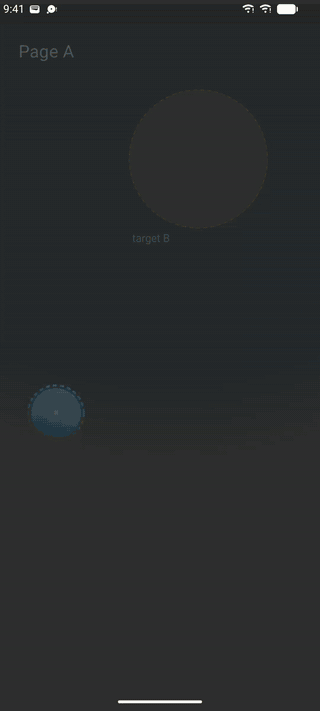
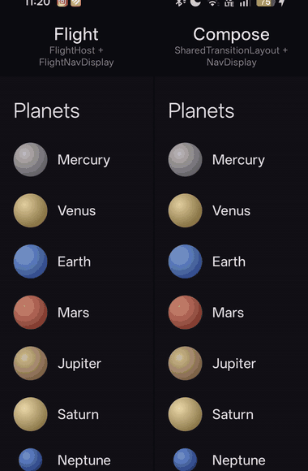

# Flight

**Interruptible shared-element flights for Jetpack Compose and Navigation 3.**

Elements fly between screens as physical objects — a centre, a size and a look, each on a spring —
instead of as segments of a transition. The target is read from the back stack, which changes the
instant the user taps, so going back halfway through a flight is *the same flight with a new target*:
it curves round from where it is, at the speed it has. Nothing is rewound, nothing jumps, and nothing
waits for the page underneath to finish moving.

<p align="center">
  
</p>
<p align="center"><sub>
  The two anchors of one element (dashed), the spring pulling it towards the one the back stack points at,
  and the trail of its centre. Push, pop, a flight interrupted both ways, a predictive back gesture held,
  cancelled and completed. Slow motion ×2 (the system animator scale, which Flight honours) ·
  <a href="docs/media/flight.mp4">mp4</a>
</sub></p>

- **Interruptible everywhere.** Push, pop halfway, push again: the element never jumps or loses its speed.
  Pages are springs too, so the pages turn round with it.
- **Predictive back.** Under the back gesture the element hangs between the two pages, following the
  finger; let go and it carries on at the speed the finger gave it.
- **The tap lands.** Go back and tap the list again while the page you left is still sliding off it:
  the tap opens what you tapped. The page on its way out is drawn on top, but touched last.
- **Drawn, not recorded — or recorded, when you want.** An element in the air is drawn by a
  `FlightPaint` you write (sharp at every size, no layout), or flown as the screen's own drawing with
  `recordedFlightAnchor` (a title at two type scales, cross-faded as it grows).
- **Cheap.** One frame loop, running only while something flies. A frame of flight redraws one overlay:
  no recomposition, no layout, not even the pages' own drawing.
- **Lands exactly.** It rides lists that scroll under it, and lands on its anchor only once the anchor's
  page has stopped, so the hand-over from the air to the page is invisible.

Flight comes from [Big Goal](https://github.com/angelomarzocchi), where it replaced the
`SharedTransitionLayout` + `NavDisplay` pair because their transitions could not be interrupted.

## Flight and Compose's shared elements, side by side

<p align="center">
  
</p>
<p align="center"><sub>
  The same scene played twice at the same instants: on the left by Flight, on the right by Compose's
  <code>SharedTransitionLayout</code> + Navigation 3's <code>NavDisplay</code>, as in the Navigation 3
  sample. Everything that can be the same is: the pages slide and fade on the same spring, the elements
  move on the same spring, the title cross-fades as it grows on both. Slow motion ×2 ·
  <a href="docs/media/compare.mp4">mp4</a> ·
  <a href="demo/src/main/kotlin/io/github/angelomarzocchi/flight/demo/Versus.kt">the scene</a>
</sub></p>

Open and back, both engines look alike. The difference is in what users do all the time: changing
their mind before the motion is over. Swipe back and tap the planet again straight away, and
Compose's planet has to finish the way back before it can set off again — it stops, jumps onto the
new way and stutters; Flight's turns round where it is, at the speed it has.

**And the tap lands.** Going back, the page you leave slides off over the list, and with `NavDisplay`
it keeps the touches until it is gone: tap the list again too soon and nothing happens. Flight draws
the page leaving on top but hands the touches to the page on top of the stack, the list, as soon as it
is on screen. Saturn tapped again *n* frames after going back, at 60 Hz:

| Frames after back | 1 | 2 | 3 | 4 | 6 | 8 | 10 | 15 | 20 |
|---|:-:|:-:|:-:|:-:|:-:|:-:|:-:|:-:|:-:|
| From a page at rest · Compose | – | – | – | ✓ | ✓ | ✓ | ✓ | ✓ | ✓ |
| From a page at rest · **Flight** | – | ✓ | ✓ | ✓ | ✓ | ✓ | ✓ | ✓ | ✓ |
| From a page sent back halfway in · Compose | – | – | – | – | – | – | – | – | ✓ |
| From a page sent back halfway in · **Flight** | ✓ | ✓ | ✓ | ✓ | ✓ | ✓ | ✓ | ✓ | ✓ |

A quarter of a second of lost taps, in the very moment users change their mind twice. From
[`TapDuringPopTest`](demo/src/test/kotlin/io/github/angelomarzocchi/flight/demo/TapDuringPopTest.kt),
which runs in CI; on Flight the first frame is the one before the list is composed again.

**Smoother, for less work.** The same script, timed on a phone (OPPO CPH2791, Android 16, display at
120 Hz), release build, medians of five cold runs each:

| | `SharedTransitionLayout` + `NavDisplay` | Flight | |
|---|---:|---:|---:|
| Stutters: a frame held still mid-motion | 9 · 13 refreshes lost | **3 · 3 refreshes lost** | 3× fewer |
| Frames late through the app's fault | 1.10 % | **0.72 %** | |
| CPU per frame, P50 / P90 | 4.6 / 6.6 ms | **3.3 / 4.7 ms** | −27 % / −28 % |
| Main thread CPU, whole script | 2 654 ms | **2 276 ms** | −14 % |
| … measuring and laying out | 321.9 ms | **49.9 ms** | −84 % |
| … recomposing | 177.1 ms | **88.7 ms** | −50 % |
| … recording the drawing | 517.1 ms | **277.6 ms** | −46 % |
| Java heap, at its highest | 17.6 MB | **15.7 MB** | −11 % |
| Private memory (RSS anon), at its highest | 87.2 MB | **81.7 MB** | −6 % |

**Less work is not more frames per second.** The display sets the rate, and both engines keep up with
it nearly always: a frame ready early waits for the next refresh all the same. What the work saved buys
is *margin*. At 120 Hz a frame has 8.3 ms; nine frames in ten, a Compose transition uses up to 6.6 ms of
them, Flight up to 4.7. Fewer frames come close to the deadline, so fewer miss it — three stutters where
Compose has nine — and the time Flight does not take is left to your pages, on a slower phone more
than on this one. Nor does Flight's share grow with your pages: a frame of flight redraws one overlay
whatever the pages hold, where a transition measures and places them again on every frame.

The jump itself, when a transition is cut short, is no late frame: every frame is on time, and shows
the planet somewhere it was not a frame before. No frame metric sees it; the recording does. How each
number is measured, and the rest of them, in [How light is it](#how-light-is-it).

## Install

Flight is published on [JitPack](https://jitpack.io/#angelomarzocchi/compose-flight).

```kotlin
// settings.gradle.kts
dependencyResolutionManagement {
    repositories {
        google()
        mavenCentral()
        maven("https://jitpack.io")
    }
}

// build.gradle.kts of your app
dependencies {
    implementation("com.github.angelomarzocchi:compose-flight:1.0.0")
}
```

Requires minSdk 24, compileSdk 37, Compose BOM `2026.09.00` or later and Navigation 3 `1.2.0`
(both come with the library as `api` dependencies).

## Quick start

Three pieces: a **host** round the navigation, the navigation itself (**`FlightNavDisplay`**, a
drop-in for `NavDisplay`), and an **anchor** on each screen where the element sits, with the same key.

```kotlin
@Composable
fun App() {
    val backStack = remember { mutableStateListOf<Any>(Home) }
    FlightHost(Modifier.fillMaxSize()) {
        FlightNavDisplay(
            backStack = backStack,
            entryProvider = entryProvider {
                entry<Home> { PlanetList(onOpen = { backStack += Detail(it) }) }
                entry<Detail> { PlanetPage(it.planet) }
            },
        )
    }
}

// One look for the element in the air: a disc of the colour each end gave its anchor.
val Disc = FlightPaint { size, from, to, morph ->
    drawCircle(lerp(from as Color, to as Color, morph), radius = size.minDimension / 2f)
}

@Composable
fun PlanetDisc(planet: Planet, modifier: Modifier) {
    // Same key on every screen = one element.
    val anchor = rememberFlightAnchor(key = "planet-${planet.id}", paint = Disc)
    anchor?.look = planet.color
    Canvas(
        modifier
            .flightAnchor(anchor) // where it rests on this screen
            .flightHole(anchor),  // empty while it is anywhere else
    ) { drawCircle(planet.color) }
}
```

Put `PlanetDisc` in the list row at 48dp and on the detail page at 220dp: tapping a row flies the disc
into the page, and back flies it home.

### Flying the screen's own drawing

For something that is the same thing drawn twice — a title at two type scales — record it instead of
painting it:

```kotlin
@Composable
fun PlanetName(planet: Planet, style: TextStyle) {
    val anchor = rememberFlightAnchor("name-${planet.id}", remember { RecordedPaint(single = false) })
    Text(planet.name, style = style, modifier = Modifier.recordedFlightAnchor(anchor))
}
```

`RecordedPaint(single = false)` cross-fades the two recordings as the bounds grow from one to the
other; `single = true` flies only the larger one, scaled.

### Moving with the page

What is on a page and should come and go *with* it — rather than fly — reads the page's presence:

```kotlin
val shown by LocalPagePresence.current?.rememberShown() ?: remember { mutableFloatStateOf(1f) }
Text(blurb, Modifier.graphicsLayer { alpha = shown })
```

There is no `LocalNavAnimatedContentScope` inside `FlightNavDisplay`; use `LocalPagePresence`.

## API at a glance

| | |
|---|---|
| `FlightHost(state, springs) { … }` | The frame loop and the overlay flights are drawn in. Put it round the navigation. |
| `FlightNavDisplay(backStack, …, pageMotion, gestureMotion, entryProvider)` | `NavDisplay` with pages on springs, telling the host what is on screen and the back gesture. |
| `rememberFlightAnchor(key, paint, layer)` | This screen's copy of an element. Null outside a host or with a null key. |
| `Modifier.flightAnchor(anchor)` / `Modifier.flightHole(anchor)` | Where the element rests here / leave its place empty while it is away. |
| `Modifier.recordedFlightAnchor(anchor)` + `RecordedPaint` | Fly the screen's own drawing. |
| `FlightAnchor.look` | What this end looks like, handed to your `FlightPaint` as `from`/`to`. |
| `FlightAnchor.held` | Under a back gesture the element stays with its screen, which moves it, and takes off when the page changes. |
| `FlightAnchor.canLand` | Whether the element may land on this end now: until then it waits in the air, drawn whole. For an end that is itself fading. |
| `FlightPaint { size, from, to, morph -> }` | Draws the element in the air, `morph` 0→1 from one end's look to the other's. |
| `progressBetween(from, to, value, fallback)` | How far a growing element has grown: drive the rest of a morph off its size. |
| `FlightLayer.Chrome` + `FlightOverlay(state, layer)` | For an element that flies out of the app bars, over them. |
| `PageMotion`, `DefaultPageMotion` | How a page moves as its presence goes 0→1: slide, fade, scale, a veil (`under`/`over`), `covers`. |
| `LocalPagePresence` | A page's presence, for what moves with it. |
| `FlightSprings`, `FlightSpring` | The springs: spatial (with a small bounce), effects, gesture. |
| `FlightHostState.isInAir(key)`, `drawnBounds(key)` | For tests: whether an element flies, where it is drawn. |

### Your theme's springs

The defaults are Material 3 Expressive's. To fly on your own motion scheme:

```kotlin
val scheme = MaterialTheme.motionScheme
FlightHost(
    springs = FlightSprings(
        spatial = FlightSpring.of(scheme.defaultSpatialSpec<Float>(), FlightSpring.Spatial),
        effects = FlightSpring.of(scheme.defaultEffectsSpec<Float>(), FlightSpring.Effects),
    ),
) { … }
```

### Flying over the bars

A `FlightHost` inside a `Scaffold` draws its flights under the top bar, as the pages are. For an element
that lives in a bar (an avatar opening a profile), give its anchors `layer = FlightLayer.Chrome` and put
an overlay over the whole chrome:

```kotlin
val host = remember { FlightHostState() }
Box {
    Scaffold(topBar = { MyBar() }) { padding ->
        FlightHost(Modifier.padding(padding), state = host) { FlightNavDisplay(…) }
    }
    FlightOverlay(host, FlightLayer.Chrome, Modifier.matchParentSize())
}
```

The bar's own copy of the element sits outside any page; that is fine — an anchor on no page is where
the element goes home to when no page on top has it.

## How it works

Each element is a `FlightBody`: centre, size and morph, each with a velocity, stepped on
animation-core's analytic spring every frame. A frame works out an *aim* from the navigation: the
anchor on the page on top; under a back gesture, a point between the top page's anchor and the one
behind it, as far as the gesture has gone; or, when no page on top has the element, home to where it
was going. Changing the aim is all an interruption does, so nothing can jump.

It takes off from where its anchor is drawn that very frame, page transition and all, inheriting the
page's speed. It lands — hands itself back to the anchor — only once it is on its target and still,
and the target's page has stopped moving: so the anchor draws it exactly where it already was.

The pages are presences on springs (`PresenceDisplay`): a change of page changes targets, never a
presence, so the same rule holds for them.

## How light is it

### Counted: the work a flight asks of your pages

[`CostTest`](demo/src/test/kotlin/io/github/angelomarzocchi/flight/demo/CostTest.kt) plays the script of
the recording above on both engines side by side, frame by frame, with every piece of the pages — the
pages, the rows, the planets, the titles, the text — counting how many times it is composed, measured,
placed and drawn. Counted rather than timed, so the numbers are the same on every machine, and the test
runs in CI:

| The script, 843 frames | `SharedTransitionLayout` + `NavDisplay` | Flight |
|---|---:|---:|
| Compositions | 131 | 127 |
| Measures | 3 052 | **104** |
| Placements | 3 234 | **180** |
| Draws | 5 131 | **542** |

Neither engine recomposes on every frame: composing costs the same on both, once per change of page.
The difference is in layout and drawing. Compose measures and draws the element again on every frame of
a transition, and places the sliding pages again; Flight moves the pages on a layer and draws the
element in an overlay, so the pages' content is laid out and drawn when the page changes — not 60 or
120 times a second while it moves. **29× fewer measures, 18× fewer placements, 9× fewer draws.**

```
./gradlew :demo:testDebugUnitTest
```

### Timed: frames, CPU and memory on a phone

[`:benchmark`](benchmark/src/main/kotlin/io/github/angelomarzocchi/flight/benchmark/FlightBenchmark.kt)
is a [Macrobenchmark](https://developer.android.com/topic/performance/benchmarking/macrobenchmark-overview)
that plays the same script on a real phone, once per engine, on the demo's release build (R8, not
debuggable, compiled ahead of time), from a cold process, five times each. It measures:

| Metric | What it is |
|---|---|
| `stutters`, `stutterRefreshesLost` | stutters as the eye sees them: in the middle of a motion, the screen showing the same frame for two refreshes or more, read from the instants the app's frames reached the screen |
| `frameDurationCpuMs` | CPU time to produce a frame, UI thread + RenderThread (P50…P99) |
| `frameOverrunMs` | how late a frame was for its deadline: positive is a dropped frame |
| `appLateFrames`, `appLateFramesPercent` | frames Android's FrameTimeline marks late through the app's own fault ("App Deadline Missed"), not the system's |
| `cpuMainThreadMs`, `cpuRenderThreadMs`, `cpuProcessMs` | time the app's threads ran on a CPU over the whole script, from the scheduler's own trace — the RenderThread is where frames become GPU commands |
| `recomposeSumMs`, `measureAndLayoutSumMs`, `drawRecordSumMs` | where the main thread's time goes: composing, laying out, recording the drawing |
| `memoryHeapSizeMaxKb`, `memoryRssAnonMaxKb`, `memoryGpuMaxKb` | memory at its highest, the GPU's included where the phone reports it |

On an OPPO CPH2791 (Android 16, display at 120 Hz), medians of five cold runs of the script, both
engines in the same session:

| | `SharedTransitionLayout` + `NavDisplay` | Flight | |
|---|---:|---:|---:|
| Stutters · refreshes they held a frame still | 9 · 13 | **3 · 3** | 3× fewer |
| Frames late through the app's fault | 7 of 635 · 1.10 % | **5 of 692 · 0.72 %** | |
| CPU per frame, P50 / P90 / P95 | 4.6 / 6.6 / 7.3 ms | **3.3 / 4.7 / 6.3 ms** | −27 / −28 / −13 % |
| Frame overrun, P50 / P90 / P95 (negative is on time) | −4.0 / −1.9 / −1.0 ms | **−6.2 / −4.6 / −2.4 ms** | |
| CPU, main thread | 2 654 ms | **2 276 ms** | −14 % |
| Main thread: measure and layout | 321.9 ms | **49.9 ms** | −84 % |
| Main thread: recomposing | 177.1 ms | **88.7 ms** | −50 % |
| Main thread: recording the drawing | 517.1 ms | **277.6 ms** | −46 % |
| CPU, RenderThread | 1 543 ms | **1 390 ms** | −10 % |
| CPU, whole process | 5 050 ms | **4 577 ms** | −9 % |
| Java heap, at its highest | 17.6 MB | **15.7 MB** | −11 % |
| Private memory (RSS anon), at its highest | 87.2 MB | **81.7 MB** | −6 % |
| GPU memory, at its highest | 68.3 MB | 68.3 MB | same |
| Frames drawn | 635 | 692 | +9 % |

Three things to read with it:

- **A finger rests on the screen.** Phones with an adaptive display lower their rate a moment after
  the last touch, whatever the app asks for: this one drops to 60 Hz a second after the finger lifts,
  so a script that plays by itself would be measured at 60 Hz. The benchmark rests a finger on a label
  that no longer reacts for the whole script, and both engines are measured at the 120 Hz users get
  under their fingers; the traces show the display at 120 Hz throughout. For the same reason the
  script's back gestures move one step a frame, as a finger does, and not at a rate of their own.
- **Flight draws more frames.** Its springs run until the element is still and its page has stopped,
  where a transition ends at its end; the extra frames are the last pixel of a spring settling. The
  per-frame and per-thread numbers above are with them.
- **The slowest 1 % of frames waits, it does not work.** `frameDurationCpuMs` P99 is 16.4 ms for
  Flight against 11.4 ms, but it counts the time the RenderThread waits for the system to hand a
  buffer back. In Flight's slowest 1 % of frames that wait is 5.0 of 7.9 ms (Compose's: 2.0 of 5.7):
  the queue is full because the app is a frame ahead of the display — "Buffer Stuffing" to Android's
  FrameTimeline, which counts it as the system's, not as work. Without the wait Flight's slowest frames
  work 2.9 ms, Compose's 3.7, and the P99 of `frameOverrunMs` is the same for both, +7.6 and +7.7 ms.
  These tails move from one session to the next on the same phone, which is why both engines are
  measured in one.

```
# a phone connected (by cable is steadier), unlocked, screen on; animations at 1x
./gradlew :benchmark:connectedBenchmarkAndroidTest
```

The results land in `benchmark/build/outputs/connected_android_test_additional_output/`, a
`*-benchmarkData.json` and a Perfetto trace per run, which open in [ui.perfetto.dev](https://ui.perfetto.dev).
On an emulator add `-Pandroid.testInstrumentationRunnerArguments.androidx.benchmark.suppressErrors=EMULATOR`:
its numbers say whether the benchmark runs, not how fast a phone is.

## Demo

`demo/` is a list of planets that fly into their pages. `CompareActivity` is the side-by-side recording
above: `adb shell am start -n io.github.angelomarzocchi.flight.demo/.CompareActivity`. "Flight · try
both" (`TryActivity`, with an icon of its own) is the same scene for your finger, one engine at a time
with a switch between Flight and Compose: go back, change your mind, tap again. `ExplainActivity` is the diagram at the top, which
plays by itself: `adb shell am start -n io.github.angelomarzocchi.flight.demo/.ExplainActivity` (set
the animator duration scale to 2 in developer options for the slow-motion version). Open the project in Android Studio and run
`demo`, or `./gradlew :demo:installDebug`. Try going back halfway through a flight, and holding a
predictive back gesture.

## Tests

```
./gradlew :flight:testDebugUnitTest
```

Unit tests for the spring body (frame-rate independence, turning round without a jerk, landing) and
Robolectric tests that drive a real `FlightHost` + `FlightNavDisplay` frame by frame: a push flies and
lands, popping halfway turns the same flight round with no jump, and a predictive back gesture holds
the element between the two pages, cancelling and completing. A paint draws in the element's own
bounds. `:demo:testDebugUnitTest` is the cost against Compose's shared elements, above.

## Using it with an AI coding assistant

[`skills/compose-flight/SKILL.md`](skills/compose-flight/SKILL.md) teaches an LLM how to use Flight
correctly: the three pieces, the rules that keep a flight smooth, and the mistakes to avoid. With
Claude Code, copy the folder into your project's `.claude/skills/`; other assistants can be pointed at
the file.

## License

Apache 2.0 — see [LICENSE](LICENSE).
